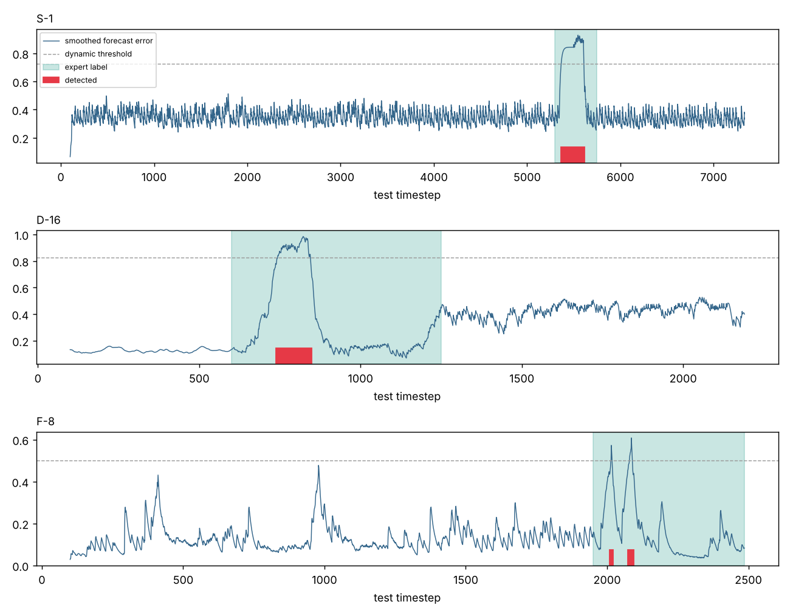

# Spacecraft Anomaly Detection

An LSTM learns the normal behavior of spacecraft sensor readings and flags anything unusual, like a drifting sensor or a sudden spike.

**Data:** real telemetry from NASA's SMAP satellite and the Curiosity rover (MSL), 81 channels, with anomalies labeled by experts at NASA JPL ([Hundman et al., KDD 2018](https://arxiv.org/abs/1802.04431)).

## Method
1. **Forecast.** One LSTM per channel (2 layers, 64 units) is trained on that channel's anomaly-free train split to predict the next value from the previous 100 steps (telemetry value + command features).
2. **Score.** On the test split, absolute forecast error is smoothed with an EWMA.
3. **Threshold.** A dynamic threshold (simplified Hundman et al. nonparametric method) picks `mean + z·std` per channel, flagged points are grouped into sequences, and weak sequences are pruned.
4. **Evaluate.** Sequence-level scoring against the expert labels: a labeled anomaly counts as detected if any predicted sequence overlaps it; a predicted sequence overlapping no label is a false positive.

## Results (all 81 channels, 105 labeled anomaly sequences)
| | channels | anomalies | TP | FP | FN | precision | recall | F1 |
|---|---|---|---|---|---|---|---|---|
| All | 81 | 105 | 32 | 5 | 73 | 0.865 | 0.305 | 0.451 |
| SMAP | 54 | 69 | 22 | 3 | 47 | 0.880 | 0.319 | 0.468 |
| MSL | 27 | 36 | 10 | 2 | 26 | 0.833 | 0.278 | 0.417 |

The detector is **conservative**: high precision, low recall. Many labeled anomalies produce no large forecast error with this model and threshold. Single run, seed 0, no hyperparameter tuning. Numbers are not directly comparable to published results that use different scoring or tuned settings.



## Reproduce
```
pip install torch numpy pandas matplotlib
# put per-channel arrays in data/train/<chan>.npy, data/test/<chan>.npy and labeled_anomalies.csv in data/
python anomaly.py      # ~12 min on 4 CPU cores -> results/
python plot.py
```
Per-channel results: `results/per_channel.csv`; summary: `results/summary.json`.

## Data provenance note
NASA's original S3 bucket (`telemanom/data.zip`) now returns AccessDenied. The arrays used here were fetched from a public GitHub mirror of that dataset. All 82 test-series lengths match the official `num_values` in `labeled_anomalies.csv` (from [khundman/telemanom](https://github.com/khundman/telemanom)), but values were not checksum-verified against the original archive. `data/` is git-ignored (166 MB).
