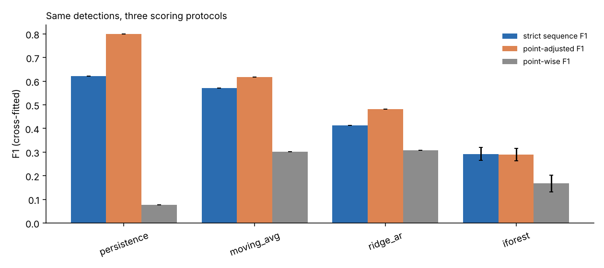

# Spacecraft Anomaly Detection on NASA SMAP / MSL Telemetry

A benchmark study of whether LSTM-style models actually beat simple baselines at flagging anomalies in real spacecraft telemetry, and why anomalies get missed.

**Data:** real telemetry from NASA's SMAP satellite and the Curiosity (MSL) rover: 81 channels, 105 anomaly sequences labeled by experts at NASA JPL ([Hundman et al., KDD 2018](https://arxiv.org/abs/1802.04431)).

> This is a careful re-evaluation of a published benchmark, not a new method. The detector family (LSTM forecaster + dynamic thresholding) is Hundman et al.'s; the contribution here is a controlled comparison with honest evaluation: cross-fitted threshold tuning, repeated fold splits, and bootstrap confidence intervals.

## Findings

1. **No neural model beats the simplest baselines.** Cross-fitted strict F1: moving average 0.67, persistence ("next value = last value") 0.60, GRU 0.59, ridge AR 0.55, LSTM-autoencoder 0.52, LSTM 0.51, CNN 0.47, Isolation Forest 0.29. The best neural model (GRU) is statistically tied with persistence (paired channel-bootstrap difference −0.007, 95% CI [−0.11, +0.09]). The moving average is nominally best, but its edge over the GRU is borderline (+0.08, CI [+0.00, +0.17]). Only Isolation Forest and the CNN are reliably worse than the GRU.
2. **The evaluation protocol moves scores more than the choice of model.** Persistence scores point-adjusted F1 0.84 but point-wise F1 0.07 on the same detections (figure below), and the split of channels into tuning/test folds alone shifts its strict F1 by ±0.12 (std over 5 random splits). A single split would have reported 0.62 for persistence; the 5-split mean is 0.60.
3. **Point anomalies are caught; contextual anomalies mostly are not.** For most models, recall on the 62 point anomalies is ~0.63–0.85 but only ~0.09–0.35 on the 43 contextual anomalies. Forecast error is largely blind to contextual anomalies.
4. **The ceiling is mostly the score, not the threshold.** For contextual anomalies only 30–47% have a peak score above the highest score in normal data (a zero-false-positive threshold exists), so no threshold could catch most of the rest.
5. **Slower smoothing is not a fix.** Allowing EWMA spans up to 500 changed contextual recall unpredictably (LSTM 0.19 → 0.37, GRU 0.28 → 0.33, moving average and CNN unchanged) and moved F1 by −0.06 to +0.07, within noise (single seed and fold split; `results/span_ablation.md`).
6. **Model settings barely matter, but capacity may help contextual anomalies.** Hidden size, window length and removing command features all leave strict F1 within noise (0.55–0.63); the only visible pattern is contextual recall rising with hidden size (0.20 → 0.32 → 0.48), a lead for follow-up rather than a conclusion (see GRU sensitivity).
7. **Tuning broadly over thresholds overfits.** Picking the best of all 33 threshold configurations on one fold generalized worse than fixing the dynamic (Hundman et al.) family for most models (e.g. GRU 0.59 vs 0.63), because each fold has only ~50 anomalies.




## Results (cross-fitted, all 81 channels)

Mean ± std over seeds × 5 random fold splits; CI is a 95% channel-level bootstrap of strict F1.

| model | runs | precision | recall | strict F1 | 95% CI | point-adj. F1 | point-wise F1 | AUROC | AUPRC |
|---|---|---|---|---|---|---|---|---|---|
| persistence | 5 | 0.616 ± 0.191 | 0.630 ± 0.061 | 0.595 ± 0.120 | [0.51, 0.71] | 0.835 ± 0.065 | 0.074 ± 0.009 | 0.661 | 0.461 |
| moving_avg | 5 | 0.751 ± 0.104 | 0.615 ± 0.008 | **0.673 ± 0.052** | [0.57, 0.77] | 0.818 ± 0.100 | 0.110 ± 0.096 | 0.655 | 0.456 |
| ridge_ar | 5 | 0.540 ± 0.202 | 0.617 ± 0.016 | 0.552 ± 0.123 | [0.48, 0.64] | 0.646 ± 0.124 | 0.185 ± 0.092 | 0.682 | 0.472 |
| iforest | 15 | 0.390 ± 0.063 | 0.228 ± 0.014 | 0.286 ± 0.024 | [0.21, 0.37] | 0.298 ± 0.072 | 0.173 ± 0.045 | 0.601 | 0.301 |
| lstm_ae | 15 | 0.583 ± 0.076 | 0.477 ± 0.062 | 0.518 ± 0.043 | [0.43, 0.61] | 0.483 ± 0.057 | 0.361 ± 0.056 | 0.646 | 0.404 |
| cnn | 15 | 0.460 ± 0.131 | 0.512 ± 0.036 | 0.471 ± 0.068 | [0.37, 0.60] | 0.615 ± 0.075 | 0.274 ± 0.103 | 0.694 | 0.462 |
| gru | 15 | 0.632 ± 0.064 | 0.564 ± 0.033 | 0.594 ± 0.035 | [0.51, 0.68] | 0.638 ± 0.083 | 0.281 ± 0.098 | 0.706 | 0.478 |
| lstm | 15 | 0.510 ± 0.094 | 0.521 ± 0.030 | 0.512 ± 0.056 | [0.42, 0.61] | 0.565 ± 0.064 | 0.304 ± 0.077 | 0.681 | 0.455 |

Deterministic baselines (persistence, moving average, ridge AR) have no seed variance, so their "runs" are the 5 fold splits only. Full tables (paired differences, false alarms per 10k steps, detection delay, threshold ablation) are in [`results/summary.md`](results/summary.md); per-class / length / spacecraft breakdowns with separability ceilings are in [`results/error_analysis.md`](results/error_analysis.md).

## GRU sensitivity

Does the GRU's result depend on its settings? Same protocol (cross-fitted, 5 fold splits); 2 seeds per variant, 1 for window 200 (it is ~7× slower to train). The reference GRU is restricted to the same seeds. Recall columns use fold split 0.

| variant | strict F1 | 95% CI | reference GRU | point recall | contextual recall |
|---|---|---|---|---|---|
| hidden 32 | 0.552 ± 0.071 | [0.47, 0.64] | 0.596 | 0.77 | 0.20 |
| hidden 64 (main GRU) | 0.596 ± 0.040 | [0.51, 0.68] | – | 0.78 | 0.32 |
| hidden 128 | 0.632 ± 0.028 | [0.55, 0.71] | 0.596 | 0.70 | 0.48 |
| window 50 | 0.609 ± 0.014 | [0.53, 0.68] | 0.596 | 0.75 | 0.27 |
| window 200 | 0.614 ± 0.012 | [0.53, 0.69] | 0.582 | 0.76 | 0.21 |
| no command features | 0.592 ± 0.040 | [0.51, 0.67] | 0.596 | 0.73 | 0.27 |

- **Nothing changes strict F1 beyond noise.** All variants fall between 0.55 and 0.63, inside each other's confidence intervals.
- **Command features do not help.** Dropping them leaves F1 unchanged (0.592 vs 0.596), so the model is not exploiting command context, which is one reason contextual anomalies (those that depend on context) stay hard.
- **Window length (50 vs 100 vs 200) makes no visible difference.**
- **A lead, not a result:** contextual recall rises with hidden size (32 → 64 → 128: 0.20 → 0.32 → 0.48, consistent across both seeds) while point recall dips slightly, and F1 moves only +0.04. This is one fold split and 43 contextual anomalies, so it needs hidden 256, more seeds and more splits before it can be called real.

## Method

- **Models (8):** baselines (persistence, 10-step moving average, ridge AR on 20 steps, Isolation Forest) and neural models (2-layer LSTM, 2-layer GRU, causal dilated 1D CNN: all forecast the next value from 100 steps of telemetry + command features; plus a univariate LSTM autoencoder scoring reconstruction error). One model per channel, trained only on that channel's clean train split (80% fit / 10% early stopping / 10% calibration).
- **Scores → detections:** EWMA smoothing, a threshold (static `mean + k·σ` of calibration scores, static max-margin, or Hundman et al.-style dynamic), merging into sequences, optional pruning.
- **Cross-fitted tuning:** channels are split into two folds (stratified by spacecraft). Thresholding hyperparameters (33-config grid) are tuned on one fold and applied to the other, then pooled. No configuration is scored on the channels it was tuned on (unit-tested). The whole procedure is repeated for 5 random splits.
- **Metrics:** strict sequence-level P/R/F1 (primary: a labeled anomaly is detected if any predicted sequence overlaps it; a predicted sequence overlapping no label is a false positive), point-adjusted F1, point-wise F1, false alarms per 10k steps, detection delay, AUROC/AUPRC.
- **Uncertainty:** channel-level bootstrap (2,000 resamples, shared across models so differences are paired).
- **Error analysis:** for each anomaly, whether its peak score exceeds the max / 99th percentile of normal scores in that channel, separating "the model cannot see it" from "the threshold missed it".


## Limitations (please read)

- **Small sample.** 105 anomalies over 81 channels. Bootstrap CIs on strict F1 are roughly ±0.08–0.12 wide; differences of a few F1 points should not be over-read. The CIs resample channels with the tuned configs held fixed, so they understate tuning variance, which the ±std over fold splits partly captures.
- **Strict scoring is lenient on long spans.** A labeled span can cover thousands of steps (e.g. A-8: ~3,800 of 8,400), so a stray alarm inside it counts as a detection. Point-wise F1 is far lower for every model.
- **Benchmark label quality.** The SMAP/MSL labels have been criticized in the literature (e.g. Wu & Keogh, "Current Time Series Anomaly Detection Benchmarks are Flawed"); many anomalies are ambiguous, and some are easy enough for trivial baselines. Persistence and a moving average matching or beating deep models here is consistent with that critique, not evidence that LSTMs are useless in general.
- **Neural models are not tuned per channel.** Network size, window and training schedule are fixed and shared; the sensitivity study above varies hidden size, window and command features for the GRU only, with 1–2 seeds each.
- **Dynamic thresholding uses test scores**, as in the original method; static variants use only the 10% clean calibration slice.
- **Ceiling numbers use one smoothing span (30)**, so achieved recall can exceed the zero-FP ceiling for some models (it tolerates false positives and may use another span).
- **No second dataset.** Transfer to the ESA anomaly benchmarks was out of reach (hosts unreachable from the build environment) and is the obvious next experiment.
- **Data provenance.** NASA's original S3 bucket (`telemanom/data.zip`) now returns AccessDenied. Arrays were fetched from a public GitHub mirror. All 162 train/test files are byte-identical (SHA-256) to two other independent GitHub mirrors (one an extraction of the original zip), and all 82 test-series lengths match the official `num_values` in `labeled_anomalies.csv` (from [khundman/telemanom](https://github.com/khundman/telemanom)). They were not compared against NASA's own copy. `data/` is git-ignored (166 MB).

## Reproduce

```
pip install torch numpy pandas matplotlib scikit-learn pytest
# place arrays in data/train/<chan>.npy, data/test/<chan>.npy and labeled_anomalies.csv in data/
python -m pytest -q tests
./run_all.sh persistence:0 moving_avg:0 ridge_ar:0 iforest:0 iforest:1 iforest:2   # fast
./run_all.sh lstm:0 lstm:1 lstm:2 lstm_ae:0 lstm_ae:1 lstm_ae:2                    # ~10 min per model-seed (2 threads)
./run_all.sh gru:0 gru:1 gru:2 cnn:0 cnn:1 cnn:2
./run_all.sh gru_h32:0 gru_h128:0 gru_w50:0 gru_nocmd:0 gru_h32:1 gru_h128:1 gru_w50:1 gru_nocmd:1 gru_w200:0
python -m sad.evaluate     # cross-fitted tuning, bootstrap CIs, tables -> results/
python -m sad.analyze      # error analysis, span ablation, figures
```

Job format is `model:seed[:i/n]` (the optional shard splits one job across workers). Code: `sad/data.py` (loading, folds), `sad/models.py` (detectors), `sad/detect.py` (thresholds), `sad/metrics.py`, `sad/evaluate.py`, `sad/analyze.py`. Per-channel scores are not committed (`results/scores/`); regenerate with the commands above.

## Citation

Hundman, Constantinou, Laporte, Colwell, Soderstrom. *Detecting Spacecraft Anomalies Using LSTMs and Nonparametric Dynamic Thresholding.* KDD 2018.
