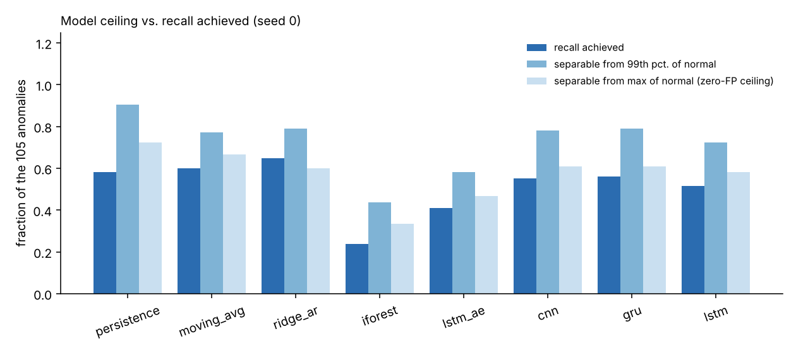
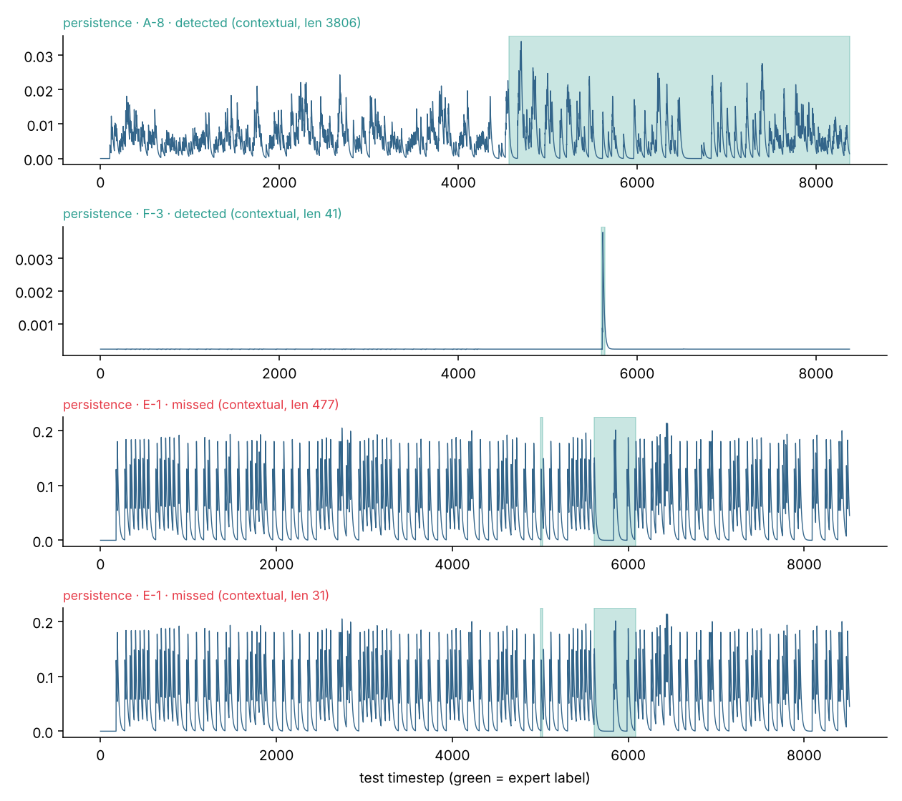

# Spacecraft Anomaly Detection on NASA SMAP / MSL Telemetry

A benchmark study of whether LSTM-style models actually beat simple baselines at flagging anomalies in real spacecraft telemetry, and why anomalies get missed.

**Data:** real telemetry from NASA's SMAP satellite and the Curiosity (MSL) rover: 81 channels, 105 anomaly sequences labeled by experts at NASA JPL ([Hundman et al., KDD 2018](https://arxiv.org/abs/1802.04431)).

> This is a careful re-evaluation of a published benchmark, not a new method. The detector family (LSTM forecaster + dynamic thresholding) is Hundman et al.'s; the contribution here is a controlled comparison with honest evaluation.

## Findings

1. **No neural model clearly beats trivial baselines.** Predicting "the next value equals the last value" (persistence) reaches strict F1 0.62, versus GRU 0.56 ± 0.03, LSTM 0.50 ± 0.04, CNN 0.40 ± 0.05 and LSTM-autoencoder 0.48 ± 0.01. Persistence is deterministic (one run); with seed std ≈ 0.03 and ~105 anomalies, persistence, moving average and GRU cannot be reliably ranked against each other (GRU with dynamic thresholding alone: 0.635 ± 0.018; moving average: 0.677).
2. **The scoring protocol can matter more than the model.** Persistence scores point-adjusted F1 0.80 but point-wise F1 0.08 on the same detections (figure below). Point-adjusted F1 rewards hitting any one point in a long labeled span.
3. **Point anomalies are caught, contextual anomalies mostly are not.** For the best models, recall on the 62 point anomalies is ~0.74–0.85 but only ~0.09–0.35 on the 43 contextual anomalies. Forecast error is largely blind to contextual anomalies.
4. **The ceiling is mostly the score, not the threshold.** For contextual anomalies, only 37–47% have a peak score above the highest score seen in normal data for the neural/baseline models (zero-false-positive ceiling), so no threshold could catch most of the rest.
5. **Dynamic thresholding (Hundman et al.) was the strongest threshold family for most models**, but choosing among all 33 configurations did worse than fixing the dynamic family: with ~50 anomalies per fold, broad tuning overfits.




## Results (cross-fitted, all 81 channels, mean ± std over seeds)

| model | seeds | precision | recall | strict F1 | point-adj. F1 | point-wise F1 | AUROC | AUPRC |
|---|---|---|---|---|---|---|---|---|
| persistence | 1 | 0.670 | 0.581 | **0.622** | 0.799 | 0.076 | 0.661 | 0.461 |
| moving_avg | 1 | 0.543 | 0.600 | 0.570 | 0.618 | 0.301 | 0.655 | 0.456 |
| ridge_ar | 1 | 0.302 | 0.648 | 0.412 | 0.483 | 0.308 | 0.682 | 0.472 |
| iforest | 3 | 0.387 ± 0.046 | 0.235 ± 0.012 | 0.292 ± 0.023 | 0.289 ± 0.022 | 0.167 ± 0.029 | 0.601 ± 0.004 | 0.301 ± 0.002 |
| lstm_ae | 3 | 0.578 ± 0.016 | 0.416 ± 0.009 | 0.483 ± 0.008 | 0.418 ± 0.018 | 0.259 ± 0.008 | 0.646 ± 0.005 | 0.404 ± 0.003 |
| cnn | 3 | 0.326 ± 0.065 | 0.530 ± 0.016 | 0.399 ± 0.046 | 0.562 ± 0.050 | 0.353 ± 0.027 | 0.694 ± 0.005 | 0.462 ± 0.008 |
| gru | 3 | 0.555 ± 0.077 | 0.578 ± 0.022 | 0.561 ± 0.032 | 0.608 ± 0.015 | 0.355 ± 0.003 | 0.706 ± 0.004 | 0.478 ± 0.002 |
| lstm | 3 | 0.490 ± 0.064 | 0.524 ± 0.008 | 0.504 ± 0.035 | 0.499 ± 0.027 | 0.324 ± 0.005 | 0.681 ± 0.002 | 0.455 ± 0.006 |

Full tables (including false alarms per 10k steps, detection delay and the threshold ablation) are in [`results/summary.md`](results/summary.md); per-class / length / spacecraft breakdowns with separability ceilings are in [`results/error_analysis.md`](results/error_analysis.md).

## Method

- **Models (8):** baselines (persistence, 10-step moving average, ridge AR on 20 steps, Isolation Forest) and neural models (2-layer LSTM, 2-layer GRU, causal dilated 1D CNN: all forecast the next value from 100 steps of telemetry + command features; plus a univariate LSTM autoencoder scoring reconstruction error). One model per channel, trained only on that channel's clean train split (80% fit / 10% early stopping / 10% calibration).
- **Scores → detections:** EWMA smoothing, a threshold (static `mean + k·σ` of calibration scores, static max-margin, or Hundman et al.-style dynamic), merging into sequences, optional pruning.
- **Cross-fitted tuning:** channels are split into two folds (stratified by spacecraft). Thresholding hyperparameters (33-config grid) are tuned on one fold and applied to the other, then pooled. No configuration is scored on the channels it was tuned on.
- **Metrics:** strict sequence-level P/R/F1 (primary: a labeled anomaly is detected if any predicted sequence overlaps it; a predicted sequence overlapping no label is a false positive), point-adjusted F1, point-wise F1, false alarms per 10k steps, detection delay, AUROC/AUPRC.
- **Error analysis:** for each anomaly, whether its peak score exceeds the max / 99th percentile of normal scores in that channel, separating "the model cannot see it" from "the threshold missed it".



## Limitations (please read)

- **Small sample.** 105 anomalies over 81 channels; seed std is ~0.03 F1 and fold choice adds more. Differences of a few F1 points should not be over-read. Persistence and moving average were run once (deterministic), so they have no seed variance, but the fold split still adds uncertainty.
- **Strict scoring is lenient on long spans.** A labeled span can cover thousands of steps (e.g. A-8: ~3,800 of 8,400), so a stray alarm inside it counts as a detection. Point-wise F1 is far lower for every model.
- **Benchmark label quality.** The SMAP/MSL labels have been criticized in the literature (e.g. Wu & Keogh, "Current Time Series Anomaly Detection Benchmarks are Flawed"); many anomalies are ambiguous, and some are easy enough for trivial baselines. Persistence outperforming deep models here is consistent with that critique, not evidence that LSTMs are useless in general.
- **Not tuned per model.** Network sizes, window length and training schedule are fixed and shared; better-tuned neural models may do better. Static-threshold variants use a 10% clean calibration slice; the dynamic threshold uses test scores, as in the original method.
- **Ceiling numbers use one smoothing span (30)**, so the achieved recall can exceed the zero-FP ceiling for some models (it tolerates false positives and may use another span).
- **Data provenance.** NASA's original S3 bucket (`telemanom/data.zip`) now returns AccessDenied. Arrays were fetched from a public GitHub mirror; all 82 test-series lengths match the official `num_values` in `labeled_anomalies.csv` (from [khundman/telemanom](https://github.com/khundman/telemanom)), but values were not checksum-verified against the original archive. `data/` is git-ignored (166 MB).

## Reproduce

```
pip install torch numpy pandas matplotlib scikit-learn pytest
# place arrays in data/train/<chan>.npy, data/test/<chan>.npy and labeled_anomalies.csv in data/
python -m pytest -q tests
./run_all.sh persistence:0 moving_avg:0 ridge_ar:0 iforest:0 iforest:1 iforest:2   # fast
./run_all.sh lstm:0 lstm:1 lstm:2 lstm_ae:0 lstm_ae:1 lstm_ae:2                    # ~10 min per model-seed (2 threads)
./run_all.sh gru:0 gru:1 gru:2 cnn:0 cnn:1 cnn:2
python -m sad.evaluate     # threshold tuning + tables -> results/
python -m sad.analyze      # error analysis + figures
```

Code: `sad/data.py` (loading, folds), `sad/models.py` (detectors), `sad/detect.py` (thresholds), `sad/metrics.py`, `sad/evaluate.py`, `sad/analyze.py`. Per-channel scores are not committed (`results/scores/`, regenerate with the commands above).

## Citation

Hundman, Constantinou, Laporte, Colwell, Soderstrom. *Detecting Spacecraft Anomalies Using LSTMs and Nonparametric Dynamic Thresholding.* KDD 2018.
